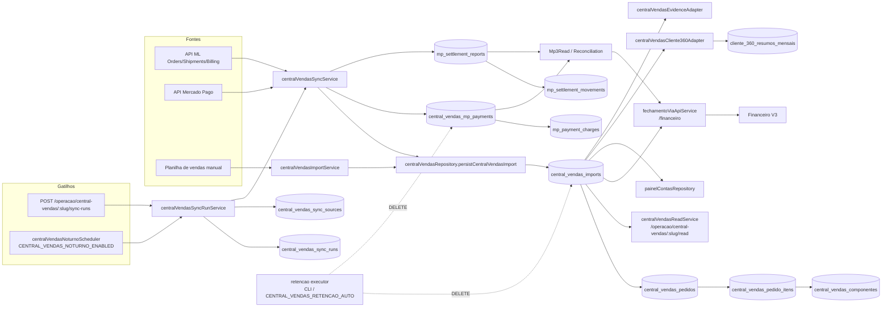
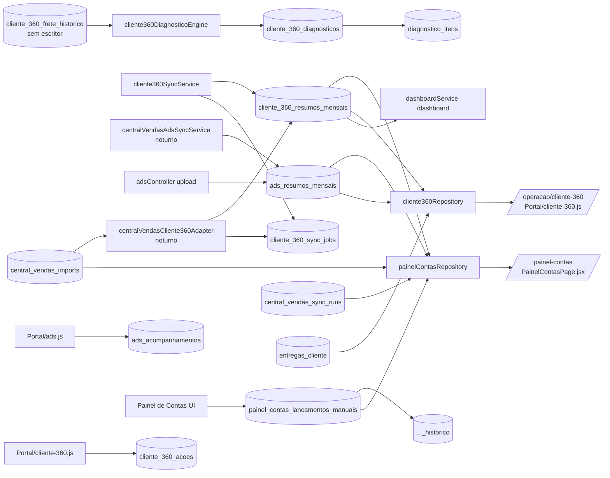
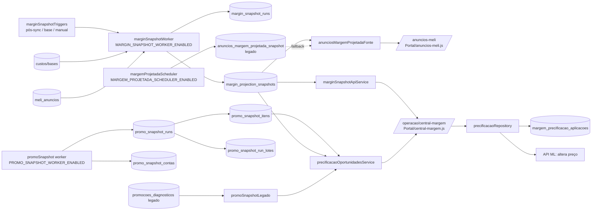
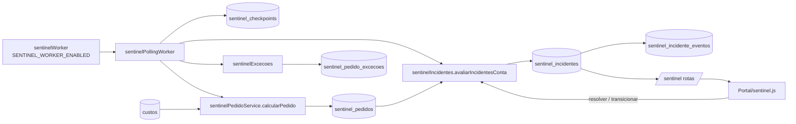

# Matriz de dependências: escritores → tabela → leitores → telas

Caminhos de serviço relativos a `server/services/`, salvo indicação. As telas vêm de chamadas de rota encontradas em `Portal/*.js|html` ou `frontend-react/src`. Quando a chamada não foi encontrada, a célula diz **[não verificado]**.
Todas as linhas são **[código]**, salvo marcação. Uma "leitura indireta" significa que a tabela é lida no servidor por outro serviço, que expõe o resultado numa rota de outro domínio.

| Tabela | Escritores | Leitores (serviço / rota) | Telas |
|---|---|---|---|
| clientes | squads/squadService.criarClienteComSquad; index.js PATCH /clientes/:slug/desativar; clientes/clientePurgeService | quase todos; `/clientes`, `/me` | Portal/clientes.js, vf-context.js, vf-shell.js |
| cliente_contas | clienteContas/clienteContaService; shopee/shopeeGrantService | Central, Painel, Margem, Promo, Sentinel; `/contas`, `/clientes/:slug/contas` | Portal/clientes.js, vf-shell.js, sentinel.js, shopee-admin.js |
| cliente_contas_pendencias | migration 20260817 | — (nenhum) | — |
| cliente_imagens | clienteImagens/clienteImagemService | idem; `/cliente-imagens` | Portal/clientes.js, bases.js |
| cliente_unificacoes / _events | clientesUnificacao/repository | idem (events sem SELECT); `/admin/clientes-unificacao` | Portal/clientes-unificacao.js |
| ml_tokens | mlTokenService (OAuth + worker de refresh); clienteContaService; index.js DELETE /clientes/:slug/ml-token | Central, Promo, C360, Design, Unificação; `/ml/*` | Portal/ml-tokens.html, clientes.js |
| users | index.js POST/DELETE /usuarios; controllers/authController.register | auth, squads, seller | Portal/usuarios.html |
| squads / squad_members / cliente_squad_history / cliente_responsaveis | squads/squadService, squadsRepository, squadsMigracaoImportService | squads/authorizationService (gate de acesso), painelContas/painelContasAcesso, Sentinel; `/squads`, `/clientes/:id/responsaveis` | Portal/squads-config.js, clientes.js |
| seller_clientes / seller_custos_submissoes | sellerService | sellerService, authorizationService, bases/baseDependenciesService; `/seller` | Portal/seller.js, usuarios.js |
| user_bases | bases/baseImportService | index.js | [não verificado] |
| bases / custos | bases/baseImportService (planilha), bases/baseCustosService, meliAnuncios/meliCustosLoteService | precificação, Central (import/sync), Sentinel (sentinelCusto), Margem (baseCustosEvidenceAdapter), Financeiro; `/bases`, `/api/bases/:slug` (API key) | Portal/bases.js, financeiro.js; extensão (via API key) [inferido] |
| base_cliente_vinculos | baseVinculosService, clienteContaService | 18 serviços; `/base-vinculos` | Portal/bases.js, financeiro.js, cliente-360.js; frontend-react hooks/useBaseVinculada.js |
| central_vendas_imports (+pedidos, itens, componentes) | centralVendas/centralVendasRepository.persistCentralVendasImport, chamado por centralVendasImportService (planilha) e centralVendasSyncService (API: run manual e scheduler noturno); retencao/centralVendasRetencaoExecutor (DELETE) | centralVendasReadService (`/operacao/central-vendas/:slug/read*`), fechamentoFinanceiro/fechamentoViaApiService (`/financeiro`), painelContas/painelContasRepository (`/painel-contas`), centralVendasCliente360Adapter (→ cliente_360_resumos_mensais), motorMargem/adapters/centralVendasEvidenceAdapter | frontend-react Financeiro V3 (indireto via `/financeiro`); Painel de Contas (indireto); nenhuma tela chama `/read` diretamente [não verificado] |
| central_vendas_sync_runs / sync_sources | centralVendasSyncRunService, centralVendasSyncSourceService | Painel, Financeiro, meService, publicação, retenção; `/operacao/central-vendas/:slug/sync-runs` | frontend-react/src/services/fechamentoViaApiApi.js:131-140 |
| central_vendas_mp_payments / charges | centralVendasMpPaymentsRepository (via centralVendasSyncService) | centralVendasMpReconciliationService, centralVendasMp3ReadService → financeiroVisaoService (`/financeiro`) | Financeiro V3 (indireto) |
| central_vendas_mp_settlement_reports / movements | centralVendasMpSettlementRepository (via centralVendasMpSettlementReportService) | Reconciliation / Mp3 read | Financeiro V3 (indireto) |
| painel_contas_lancamentos_manuais (+historico) | painelContas/painelContasRepository.salvarLancamentoManual / removerLancamentoManual | painelContasRepository; `/painel-contas` | Portal/painel-contas.html; frontend-react/src/pages/PainelContasPage.jsx, services/painelContasApi.js |
| cliente_360_resumos_mensais | cliente360/cliente360Repository.upsertResumoMensal (cliente360SyncService; centralVendasCliente360Adapter no noturno) | painelContasRepository, dashboardService (`/dashboard`), sellerService, cliente360 | Portal/cliente-360.js, dashboard.js, painel-contas |
| cliente_360_diagnosticos / itens | cliente360Repository via cliente360DiagnosticoEngine | cliente360Repository (itens: nenhum SELECT); `/operacao/cliente-360` | Portal/cliente-360.js |
| cliente_360_frete_historico | **nenhum** | cliente360Repository.js:348 | Portal/cliente-360.js (indireto) |
| cliente_360_sync_jobs | cliente360Repository.lockSyncJob/finalizeSyncJob | cliente360Repository | — |
| cliente_360_acoes | cliente360/cliente360AcoesRepository | idem; `/operacao/cliente-360` (cliente360ResultadoRoutes) | Portal/cliente-360.js |
| margin_snapshot_runs / margin_projection_snapshots | motorMargem/marginSnapshotRunRepository, marginSnapshotRepository (worker, gatilhos) | marginSnapshotApiService, anunciosMargemProjetadaFonte, precificacaoOportunidadesSql; `/operacao/central-margem`, `/anuncios-meli` | Portal/central-margem.js, central-margem-api.js, anuncios-meli.js |
| anuncios_margem_projetada_snapshot | motorMargem/margemProjetadaSnapshotRepository (margemProjetadaScheduler, jobs/margemProjetadaGlobal.js) | anunciosMargemProjetadaFonte (fallback) → `/anuncios-meli` | Portal/anuncios-meli.js |
| margem_precificacao_aplicacoes | motorMargem/precificacao/precificacaoRepository | idem; `/operacao/central-margem` | Portal/central-margem.js |
| promo_snapshot_* | promoSnapshot/promoSnapshotRepository (worker) | idem, precificacaoOportunidadesService; `/operacao/central-margem` (promoSnapshotRoutes) | Portal/central-margem-api.js |
| promocoes_diagnosticos / itens | automacoes/promocoesDiagnosticoService | idem, promoSnapshot/promoSnapshotLegado, precificacaoOportunidadesService; `/automacoes/*` | Portal/promocoes-retorno.js, automacoes.js |
| promocoes_rebate_jobs | meliAnuncios/meliPromocoesRebateService | idem; `/anuncios-meli` | Portal/anuncios-meli.js |
| meli_anuncios / meli_user_products | meliAnuncios/meliAnunciosService, meliFamiliaService (via meliSyncService) | Margem, Promo, Financeiro (financeiroMiniaturasService), Seller; `/anuncios-meli` | Portal/anuncios-meli.js |
| meli_anuncio_otimizacoes | meliAnuncios/otimizadorMeliService | idem | Portal/anuncios-meli.js |
| meli_anuncio_publicacoes | meliAnuncios/meliCriacaoService | idem | Portal/criar-anuncios-meli.js |
| sentinel_* | sentinel/sentinelPollingWorker, sentinelPedidoService, sentinelExcecoes, sentinelIncidentes | sentinelIncidentes; `/sentinel` | Portal/sentinel.js, sentinel.html |
| ads_acompanhamentos | adsService.salvarAcompanhamentoAds | adsService; `/ads` | Portal/ads.js |
| ads_resumos_mensais | adsService.salvarResumoMensalAds (controllers/adsController upload; centralVendasAdsSyncService no noturno) | cliente360Repository, painelContasRepository, adsService | Portal/ads.js, cliente-360.js |
| financeiro_ads_cache | financeiroAdsService.obterAdsDoFechamento | idem; `/financeiro` | Financeiro V3 (frontend-react services/financeiroApi.js) [inferido] |
| relatorios / relatorio_itens / relatorio_pastas | automacoes/relatoriosService, diagnosticoService, controllers/automacoesController | relatoriosService, cliente360Repository, sellerService, routes/externalFirebaseRoutes | Portal/relatorios.js, automacoes.js |
| diagnosticos_iniciais | diagnosticoInicial/diagnosticoInicialRepository | idem; `/operacao/diagnosticos-iniciais` | Portal/diagnostico-inicial.js |
| entregas_cliente | entregasClienteService | idem, dashboardService, cliente360Repository, centralVendasCliente360Adapter; `/entregas*` | Portal/financeiro.js, relatorio-publico.js, cliente-360.js; frontend-react services/entregasApi.js |
| fechamento_incidentes / arquivos | repositories/fechamentoIncidenteRepository (via fechamentoFinanceiro/incidente/fechamentoIncidentStorageService) | idem; `/fechamentos` | Portal/financeiro-debug.js [inferido pelo prefixo] |
| shopee_grants | shopee/shopeeGrantService (+ shopeeRefreshWorker) | idem; `/shopee` | Portal/shopee-admin.js |
| tiktok_shop_callback_logs | controllers/tiktokShopController.salvarCallbackLog | **nenhum** | — |
| observability_* | repositories/observabilityRepository (middleware) | observabilityService; `/admin/observability` | Portal/control-center.js |
| activity_logs | activityLogService.registrarLog (9 controllers), clientesUnificacao/repository | controllers/logsController; `/admin/logs` | Portal/atividade.js |
| callbacks | index.js GET /api/bases/:baseSlug | index.js GET /callbacks | Portal/callbacks.js |
| scans | index.js POST /scans | index.js GET /scans | [não verificado] |
| design_* | designStudio/designStudioRepository | idem; `/design/studio` | Portal/design-studio-api.js, design-templates.js |
| venforce_schema_versoes | schema/schemaVersionado | idem (boot) | — |

## Central de Vendas (incluindo MP)

## Cliente 360 e Painel de Contas

## Margem (Central de Margem / Motor / Snapshot / Promoções)

## Sentinel

